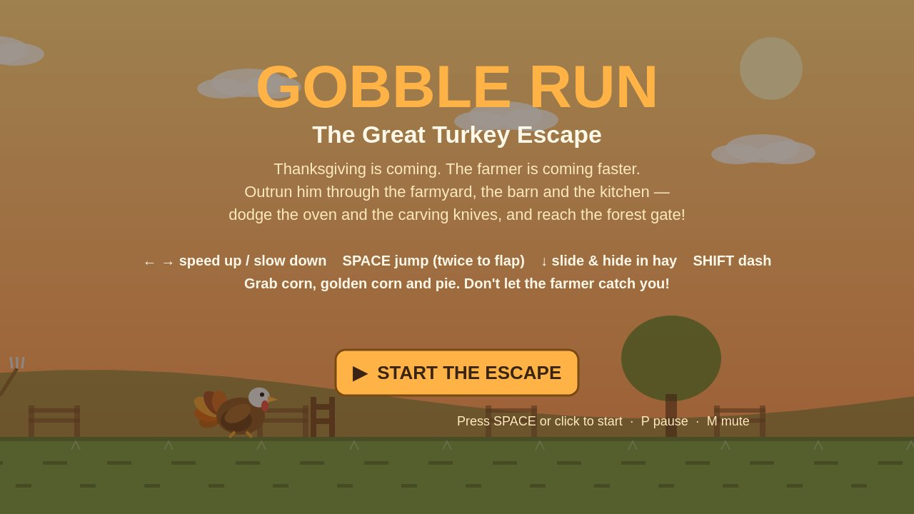
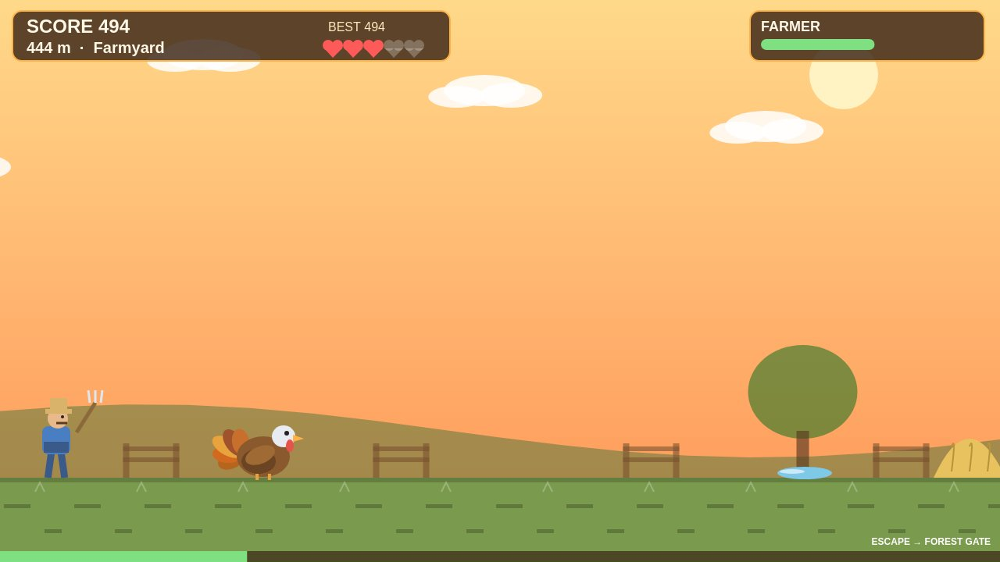
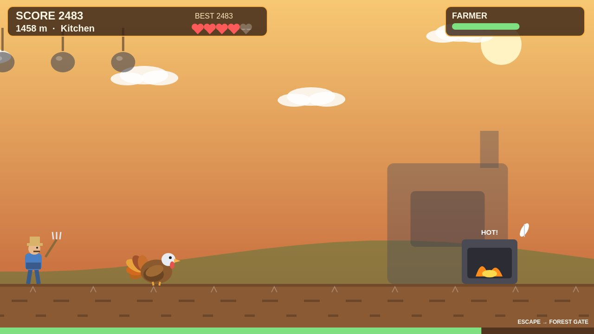
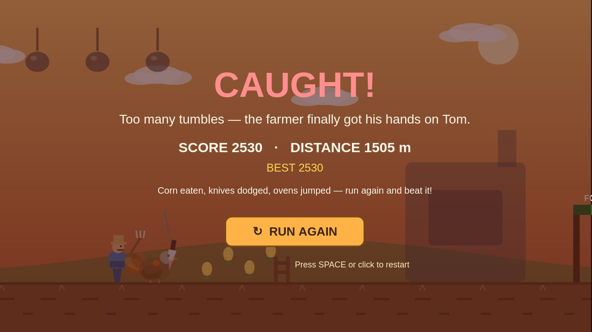

# Gobble Run — The Great Turkey Escape

A complete turkey escape game for the [make.fun bounty](https://make.fun/bounty/turkey-run-game-01): Tom the turkey has to outrun the farmer through the farmyard, the barn and the kitchen — dodging fences, pumpkins, puddles, swinging carving knives and a roaring oven — and slip through the forest gate before he becomes Thanksgiving dinner.

## How to play

Open `game/index.html` in a desktop browser (or run `node serve.ts` and open http://localhost:8080). No build step, no network, everything is self-contained.

| Key | Action |
| --- | --- |
| ← / → (or A / D) | Slow down / sprint — the farmer gains while you dawdle |
| Space / ↑ / W | Jump — press again mid-air to flap |
| ↓ / S | Slide, and hide in a haystack to lose the farmer |
| Shift / X | Dash — a burst of speed that opens up the gap |
| P | Pause · M | Mute |

Grab corn (+10), golden corn (+50), feathers (a 3-second shield) and pie slices (+1 life). Three lives: every stumble costs one and lets the farmer close in. Reach 1,800 m and the forest gate, and Tom is pardoned.

## What is inside

- `game/` — the playable game as static files: `index.html` plus ES modules under `game/src/` (world simulation, canvas renderer, synthesized Web Audio sound, input, and the deterministic screenshot stager).
- `main.ts` — the Node 22 hand-in program: copies `game/` and `screenshots/` to `/output` and writes `dossier.json`.
- `screenshots/` — real renders of the game's own code: title, farmyard run, kitchen run, and the caught end screen.
- `vendor/makefun-game.ts` — the kit's library, unchanged.

## Screenshots

## License

MIT — see [LICENSE](LICENSE).
